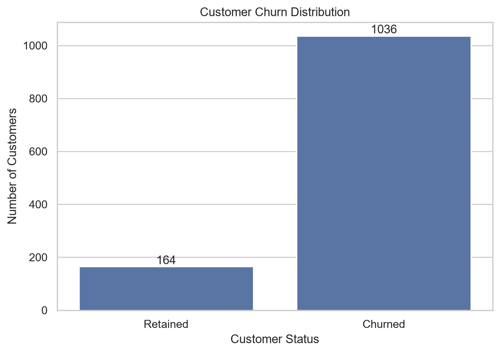
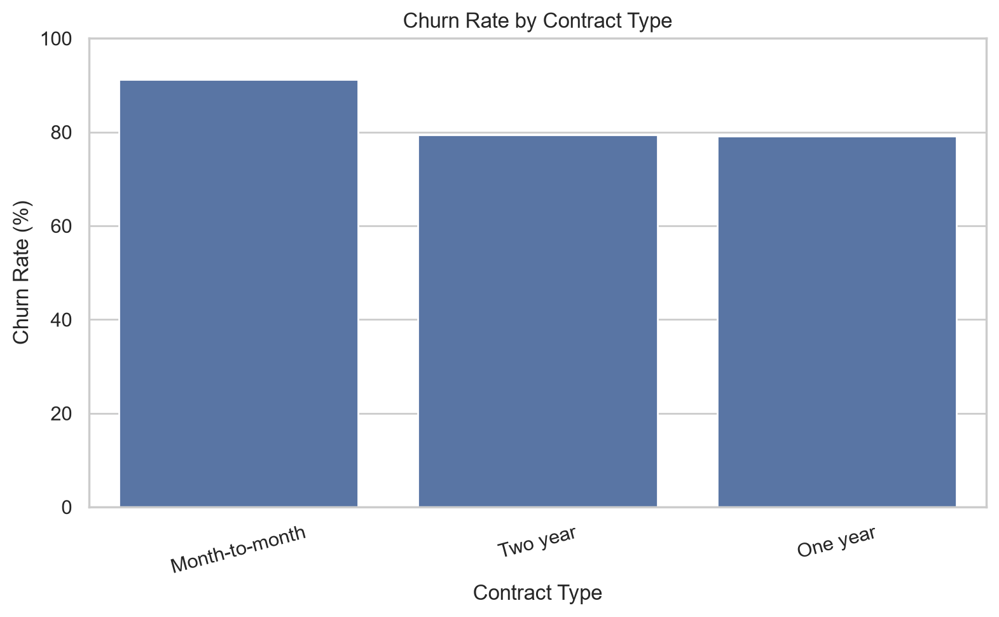
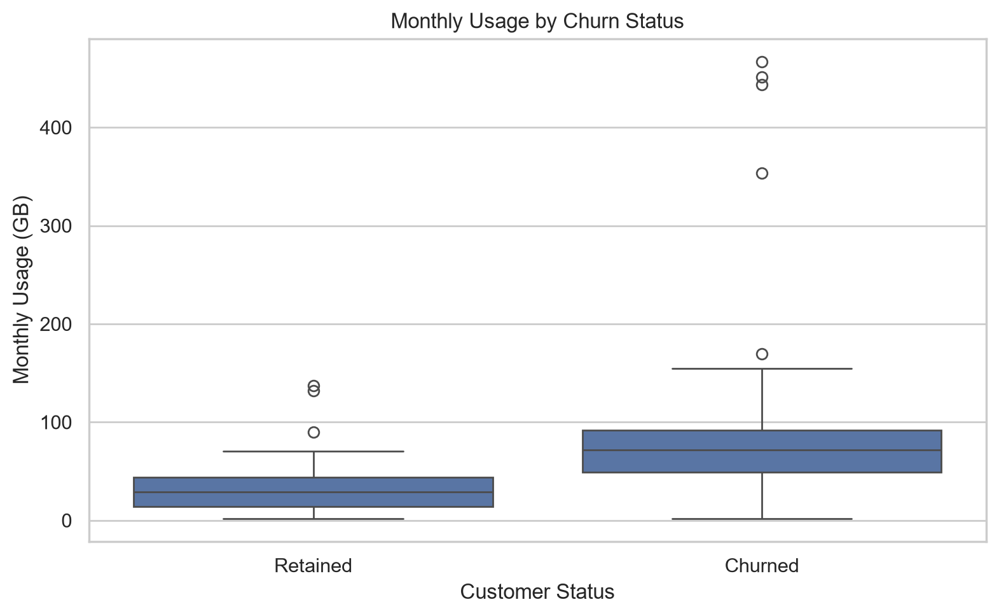
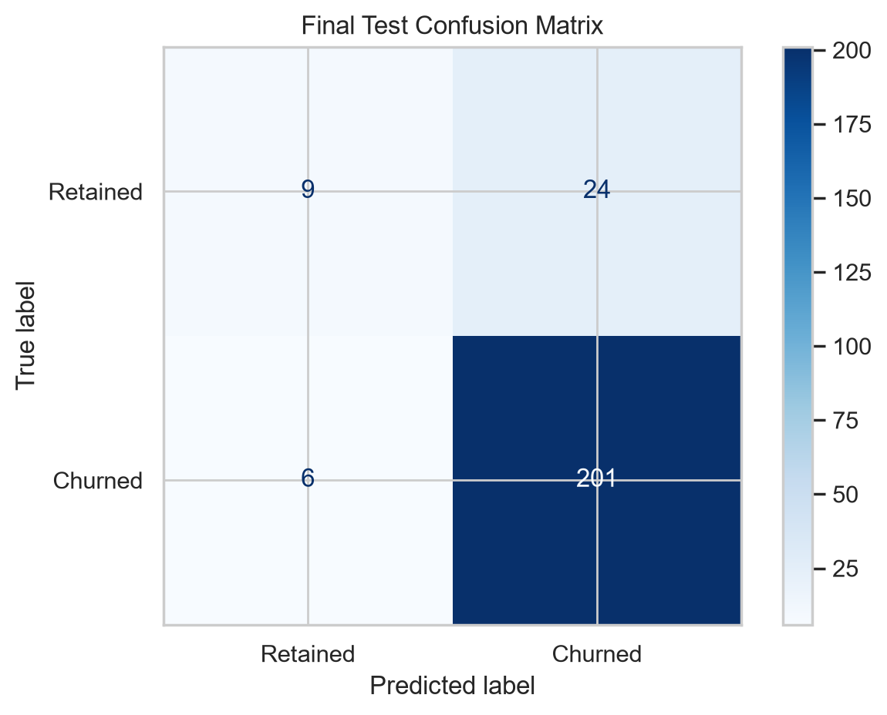
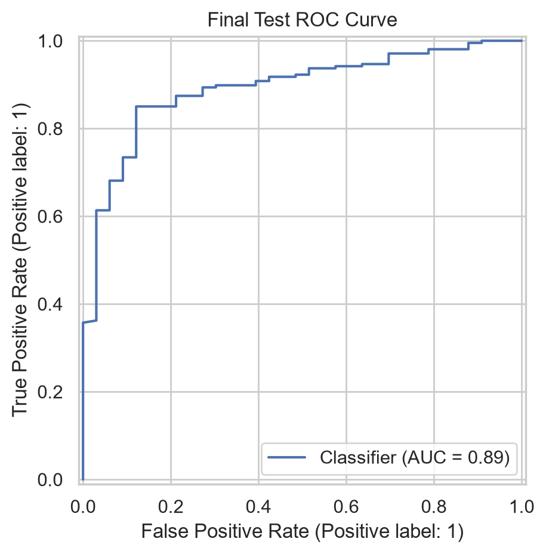
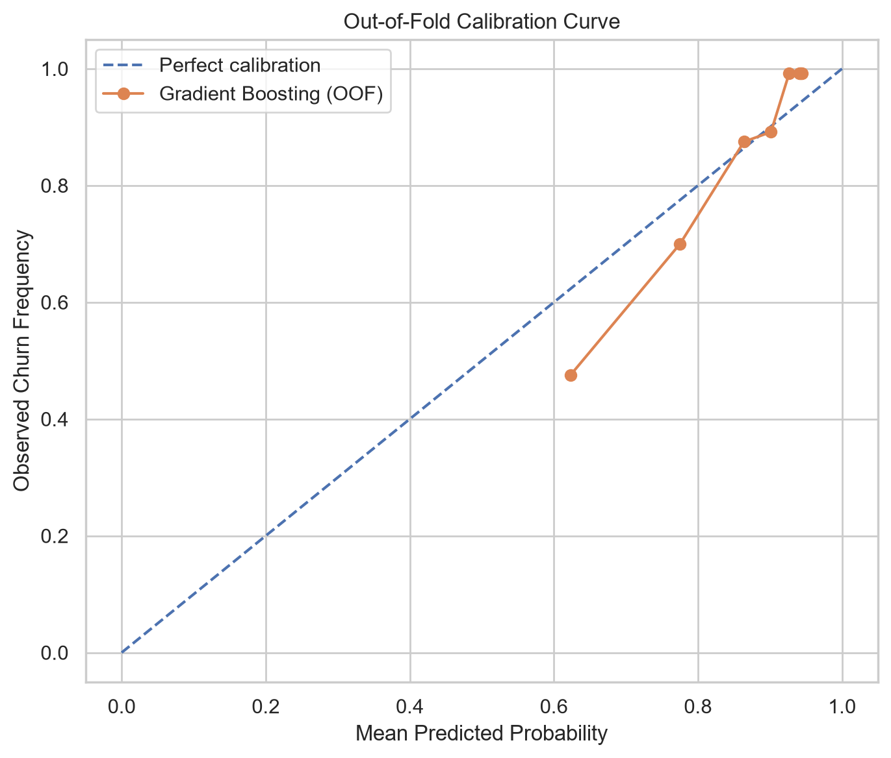
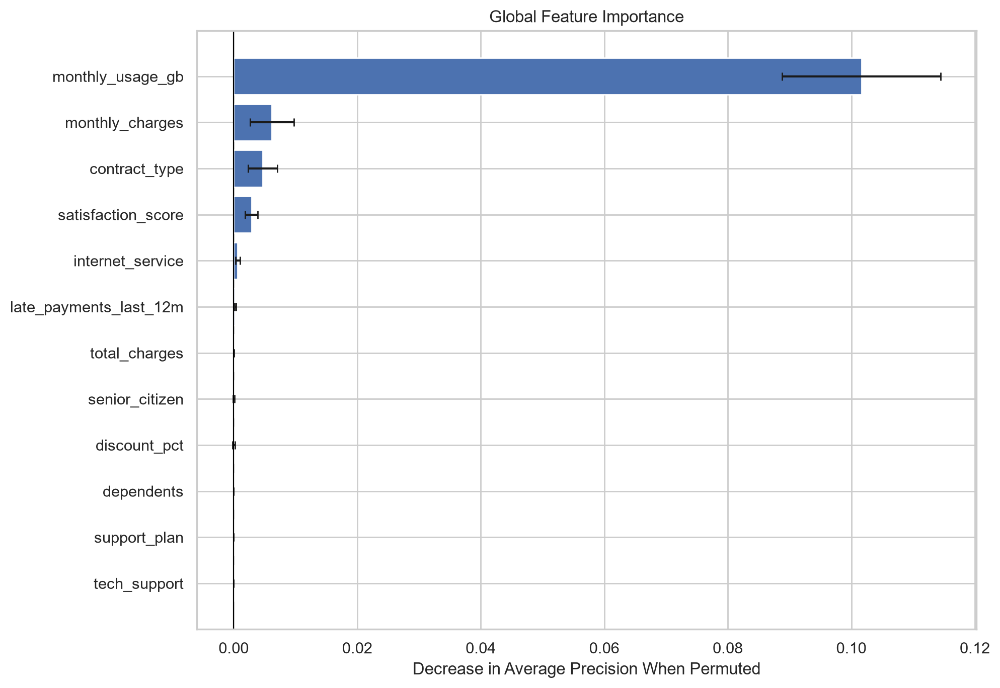
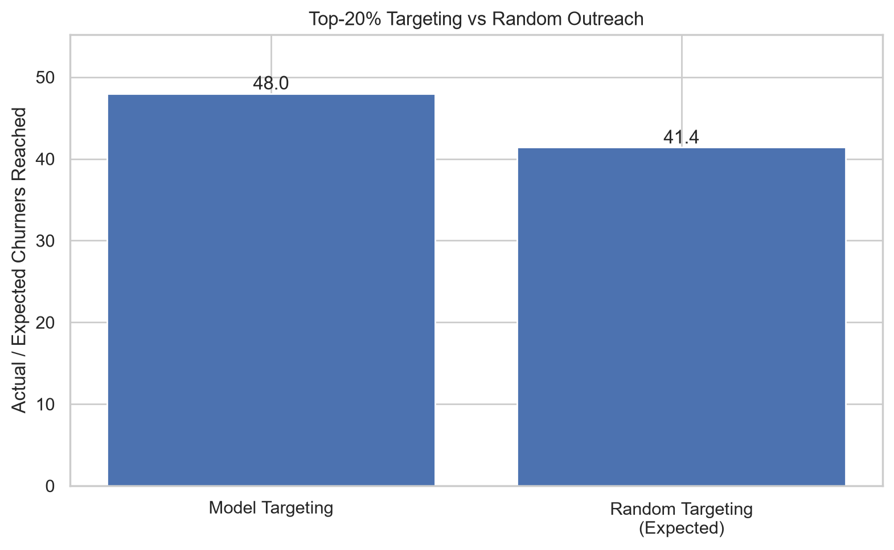
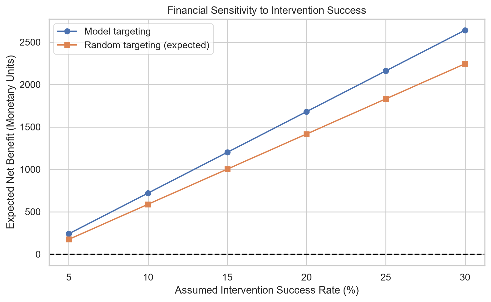

# Customer Churn Prediction & Retention Analysis

An end-to-end machine learning project for predicting subscription
customer churn, explaining model predictions, and prioritizing
retention efforts under a limited customer-contact budget.

**GitHub Repository:** [View project](https://github.com/Ishara125/end-to-end-customer-churn-prediction---retention-analysis-solution)

## 1. Project Overview

The company needs to identify customers who are likely to leave
during the next retention cycle.

However, the company can contact only the highest-risk
**20% of customers**.

The project focuses on:

- Reproducible data preparation
- Exploratory data analysis
- Leakage-safe feature engineering
- Classification model development
- Cross-validation and tuning
- Class imbalance handling
- Reliable evaluation
- Model explainability
- Customer retention targeting
- Hypothetical financial simulation

## 2. Business Problem

Customer churn can reduce subscription revenue and increase
customer-acquisition costs.

The objective is to predict churn risk and prioritize
customers for retention outreach.

**Business constraint:** Contact only the top 20% of
customers ranked by predicted churn probability.

A churn prediction does not establish whether an intervention
will prevent churn.

## 3. Dataset

Source: `customer_churn_advanced_dataset.csv`

| Attribute | Value |
|---|---:|
| Customer records | 1,200 |
| Dataset columns | 20 |
| Missing cells | 138 |
| Duplicate records | 0 |
| Duplicate customer IDs | 0 |
| Overall churn rate | 86.33% |
| Target variable | `churn` |

The dataset contains customer demographics, contract
details, charges, usage, satisfaction, complaints,
payment behavior, and churn outcomes.

The `customer_id` field is treated only as an identifier.

## 4. Technologies

- Python
- NumPy and pandas
- scikit-learn
- Matplotlib and seaborn
- Jupyter Notebook
- joblib
- ReportLab
- pytest

## 5. Project Structure

```text
.
├── data/
│   ├── raw/
│   │   └── customer_churn_advanced_dataset.csv
│   └── processed/
│       ├── 02_cleaned_dataset.csv
│       └── split_indices.json
├── notebooks/
│   └── 01_data_science_notebook.ipynb
├── src/
│   ├── data_preprocessing.py
│   ├── eda.py
│   ├── feature_engineering.py
│   ├── modeling.py
│   ├── hyperparameter_tuning.py
│   ├── evaluation.py
│   ├── explainability.py
│   └── retention_analysis.py
├── models/
│   └── 03_model_artifact.joblib
├── reports/
│   ├── figures/
│   ├── 04_business_report.pdf
│   └── analysis results (CSV/JSON)
├── tests/
├── create_notebook.py
├── create_business_report.py
├── create_readme.py
├── requirements.txt
├── README.md
└── 05_README.md
```

## 6. Data Auditing and Cleaning

The data-quality workflow checks:

- Missing values and data types
- Duplicate rows and customer IDs
- Invalid target values
- Suspicious numeric values
- Customer churn distribution

Missing predictor values are preserved in the cleaned
dataset and handled within model pipelines.

The raw dataset is kept unchanged.

## 7. Exploratory Data Analysis

EDA investigates churn patterns involving:

- Contract type
- Customer tenure
- Monthly charges
- Customer satisfaction
- Complaints
- Late payments
- Monthly usage

### Churn Distribution



### Churn by Contract Type



### Monthly Usage by Churn Status



These charts describe observed associations, not
proven causal relationships.

## 8. Feature Engineering

Five engineered features were developed:

| Feature | Purpose |
|---|---|
| `tenure_years` | Customer lifetime in years |
| `complaints_per_year` | Annualized complaint intensity |
| `late_payment_risk` | Repeated late-payment indicator |
| `charge_usage_ratio` | Monthly charges relative to usage |
| `low_satisfaction_flag` | Low satisfaction indicator |

Feature engineering is performed inside the
machine-learning pipeline.

The churn target and customer identifier are excluded
from predictor generation.

## 9. Model Development

Three classification models were implemented:

1. Logistic Regression
2. Random Forest
3. Gradient Boosting

An 80/20 stratified train/test split is used with
random seed **42**.

The reserved test set contains 240 customers.

The training partition uses five-fold stratified
cross-validation for model selection.

### Baseline Results

| Model | PR-AUC | ROC-AUC | F1 |
|---|---:|---:|---:|
| Logistic Regression | 0.9722 | 0.8694 | 0.9345 |
| Gradient Boosting | 0.9719 | 0.8704 | 0.9317 |
| Random Forest | 0.9693 | 0.8538 | 0.9312 |

## 10. Hyperparameter Tuning

`RandomizedSearchCV` was used to search eight
parameter configurations per model.

The primary selection metric was average precision
(PR-AUC).

### Tuned Results

| Model | CV PR-AUC | Recall @20% | Lift @20% |
|---|---:|---:|---:|
| Gradient Boosting | 0.9782 | 0.2340 | 1.1521 |
| Random Forest | 0.9739 | 0.2328 | 1.1462 |
| Logistic Regression | 0.9726 | 0.2316 | 1.1402 |

These are training-based model-selection diagnostics.
They are not independent nested cross-validation estimates.

## 11. Final Model Evaluation

**Selected model:** Gradient Boosting

**Operating classification threshold:**
0.67

| Evaluation Metric | Test Result |
|---|---:|
| Accuracy | 87.50% |
| Precision | 89.33% |
| Recall | 97.10% |
| F1-score | 93.06% |
| ROC-AUC | 0.8923 |
| PR-AUC | 0.9808 |
| Brier Score | 0.0902 |

### Confusion Matrix



### ROC Curve



### Class Imbalance, Threshold, and Calibration

The training set has a high churn prevalence.
Stratified splitting preserves the target distribution.

Class-weight alternatives were considered during
hyperparameter tuning. The final selected model does
not use synthetic resampling.

The operating threshold was selected using training
out-of-fold predictions, under a minimum training
precision requirement of 90%.

Probability calibration was checked using a calibration
curve and Brier score.



Fold-to-fold variability was also evaluated as
a robustness check.

## 12. Model Explainability

Global explainability uses permutation importance.

### Most Influential Features

| Predictor | Permutation Importance |
|---|---:|
| `monthly_usage_gb` | 0.1016 |
| `monthly_charges` | 0.0062 |
| `contract_type` | 0.0047 |
| `satisfaction_score` | 0.0029 |
| `internet_service` | 0.0006 |
| `late_payments_last_12m` | 0.0003 |



Three customer-level explanations were also produced.

They represent relatively low, medium, and high model
risk scores in the evaluation cohort.

Individual explanations use one-feature-at-a-time
reference replacement.

This is sensitivity analysis, not SHAP attribution
or causal interpretation.

## 13. Retention Intervention Simulation

The company can contact only the highest-risk 20%
of customers.

| Metric | Value |
|---|---:|
| Evaluation customers | 240 |
| Contact capacity | 48 |
| Actual churners captured | 48 |
| Precision @20% | 100.00% |
| Recall @20% | 23.19% |
| Lift @20% | 1.1594 |
| Random expected churners captured | 41.40 |



The random baseline represents the expected outcome
from uniformly random customer selection under
the same contact budget.

## 14. Hypothetical Financial Simulation

Assumptions:

- Contact cost: 5 monetary units
- Retained customer value: 200 monetary units
- Intervention success probability: 15%

| Strategy | Expected Net Benefit |
|---|---:|
| Model targeting | 1200.00 |
| Random targeting | 1002.00 |

All financial values are hypothetical and do not
represent observed business revenue.



## 15. Business Recommendations

1. Investigate usage-related churn-risk patterns.
2. Review billing and pricing concerns.
3. Improve follow-up for dissatisfied customers.
4. Explore contract-specific retention strategies.
5. Conduct controlled retention experiments.

These are proposed actions for business testing,
not established causal effects.

## 16. Installation

### Prerequisites

- Python 3.12 or a compatible Python version
- Git
- VS Code or another Python development environment

Clone the repository:

```bash
git clone https://github.com/Ishara125/end-to-end-customer-churn-prediction---retention-analysis-solution.git
cd end-to-end-customer-churn-prediction---retention-analysis-solution
```

Create a virtual environment:

```bash
python -m venv .venv
```

Activate it on Windows PowerShell:

```powershell
.venv\Scripts\Activate.ps1
```

Install the dependencies:

```bash
python -m pip install -r requirements.txt
```

## 17. How to Run

Execute these commands from the repository root:

```bash
python -m src.data_preprocessing
python -m src.eda
python -m src.modeling
python -m src.hyperparameter_tuning
python -m src.evaluation
python -m src.explainability
python -m src.retention_analysis
```

For Jupyter Notebook:

```bash
jupyter notebook notebooks/01_data_science_notebook.ipynb
```

Select the project Python environment before running.

To regenerate the notebook structure:

```bash
python create_notebook.py
```

To regenerate the PDF report after generating analysis results:

```bash
python create_business_report.py
```

Note: Re-running the evaluation regenerates holdout metrics.
The original test set must not be used for further model
selection or tuning.

## 18. Saved Model

The trained model is stored at:

`models/03_model_artifact.joblib`

It includes:

- Fitted feature engineering and preprocessing pipeline
- Trained Gradient Boosting classifier
- Operating threshold
- Feature column information
- Random seed metadata

Only load joblib artifacts from trusted sources.

## 19. Testing

Automated tests are maintained in the `tests/` folder.

Run them using:

```bash
python -m pytest -q
```

A complete final test run is required before submission.
Do not assume tests pass without executing them.

## 20. Reproducibility

Random seed: **42**

Python version used to generate this documentation:
**3.12.10**

Main environment package versions:

| Package | Version |
|---|---|
| pandas | 3.0.6 |
| NumPy | 2.5.4 |
| scikit-learn | 1.9.1 |
| Matplotlib | 3.11.2 |
| seaborn | 0.13.2 |
| joblib | 1.6.0 |

The same saved split manifest is reused across
training and evaluation.

## 21. Limitations

- Unusually high observed churn prevalence
- Limited dataset size
- Model-selection optimism from non-nested CV
- One reserved holdout evaluation
- Probability calibration not automatically corrected
- Predictive explanations are not causal
- Financial assumptions are hypothetical
- No observed retention-intervention response
- External validation is recommended

## 22. Project Deliverables

| Deliverable | Path |
|---|---|
| Executable Jupyter Notebook | `notebooks/01_data_science_notebook.ipynb` |
| Cleaned Dataset | `data/processed/02_cleaned_dataset.csv` |
| Saved Final Model | `models/03_model_artifact.joblib` |
| Business Report | `reports/04_business_report.pdf` |
| Assignment README | `05_README.md` |

## 23. Conclusion

This project provides a reproducible machine-learning
workflow for customer churn prediction and
budget-constrained retention prioritization.

The Gradient Boosting model offers useful risk ranking
on the supplied data, while the top-20% simulation
demonstrates the potential value of targeted outreach.

Future work should validate model performance on new
customer cohorts and measure real retention impact
through controlled experiments.

---

**Academic project:** End-to-End Customer Churn Prediction
and Retention Analysis Solution.

